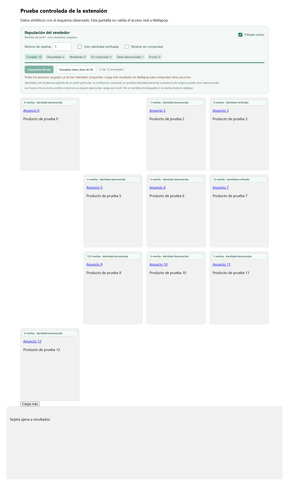

# Filtros de vendedores para Wallapop

[English](README.md) · Español · [Français](README.fr.md) · [Deutsch](README.de.md) · [Italiano](README.it.md) · [Português](README.pt.md)

Extensión local de **Chrome y Edge**, de código abierto, para filtrar resultados cargados por número de reseñas e identidad explícita del vendedor. Manifest V3, JavaScript y licencia MIT. Sin backend, telemetría, suscripciones ni llamadas a IA.

**Alcance actual:** solo `https://es.wallapop.com/`. La interfaz está en español; las traducciones del README no añaden otros dominios ni traducen la extensión. Proyecto independiente, sin afiliación con Wallapop.

## Instalar sin herramientas de desarrollo

1. En este repositorio, pulsa **Code → Download ZIP** y descomprime el archivo en una carpeta permanente.
2. Abre **Google Chrome** y escribe `chrome://extensions` en la barra del navegador. En **Microsoft Edge**, escribe `edge://extensions`. Debe ser la barra del navegador, no la del Explorador de archivos de Windows.
3. Activa **Modo de desarrollador** y pulsa **Cargar descomprimida / Cargar sin empaquetar**.
4. Selecciona la carpeta **`extension`** del proyecto descomprimido, por ejemplo `wallapop-seller-filter-main/extension`. Debe contener `manifest.json` en su raíz. No selecciones Documentos ni la raíz del repositorio.
5. Abre una búsqueda en [Wallapop España](https://es.wallapop.com/) y recarga la pestaña una vez si ya estaba abierta. Aparecerá **Reputación del vendedor** sobre los resultados.

No necesitas Node.js ni un asistente de desarrollo para utilizarla. Si construyes el proyecto, también puedes cargar la carpeta generada `dist`.

## Uso

- **Filtrado activo:** inicialmente activado y estricto. Solo muestra coincidencias comprobadas. Al desactivarlo recuperas los anuncios sin recargar.
- **Mínimo de reseñas:** inicialmente 5. El criterio es **reseñas ≥ mínimo**: exactamente 5 cumple con mínimo 5. Es el total general del perfil, no las estrellas ni solo reseñas de ventas.
- **Solo identidad verificada:** exige evidencia explícita de identidad personal. La verificación comercial y la ausencia de insignia quedan como desconocidas.
- **Mostrar sin comprobar:** muestra pendientes, desconocidos y errores con etiquetas, además de las coincidencias.
- **Comprobar 10 más:** intenta hasta diez rutas nuevas. Tras el primer lote, los resultados añadidos esperan continuación manual.
- **Reintentar errores:** consulta hasta diez rutas fallidas sin borrar la caché ni repetir las comprobadas o desconocidas.
- **Actualizar datos:** borra la caché compartida y procesa hasta diez anuncios de nuevo.
- **Reanudar consultas:** permite continuar manualmente tras un bloqueo o límite de acceso.

Los contadores separan coincidencias, descartados, consultas en curso, anuncios todavía no intentados, datos desconocidos y errores. **Procesado no significa verificado.** Si ya se han procesado todos los anuncios cargados, el botón de continuación se desactiva; los desconocidos y los errores se cuentan aparte.

Los anuncios ocultos mantienen su hueco y orden para evitar mover los disparadores de scroll. Se filtran **resultados cargados y procesados**, no todo el catálogo. Cero coincidencias comprobadas con datos incompletos no demuestra que no existan vendedores válidos.

## Consultas y privacidad

Una consulta simultánea entre pestañas, al menos tres segundos entre inicios y diez rutas distintas por lote. Se lee el HTML de las fichas enlazadas sin inventar endpoints ni descargar código ejecutable remoto.

Caché local con validez de 24 horas: ID de vendedor, contador, evidencia de identidad, fecha, URL de origen y asociación anuncio-vendedor. La limpieza se hace al acceder a la caché; no es un borrado automático programado. También se guardan preferencias y estado de pausa. No se inspeccionan ni guardan valores de cookies o credenciales, ni se conservan nombres, teléfonos o textos de reseñas. Las consultas normales a Wallapop pueden incluir las cookies de sesión que gestione el navegador.

Solo se solicitan `storage` y acceso a `https://es.wallapop.com/*`. HTTP 429 pausa y respeta `Retry-After`; 401/403 o CAPTCHA detienen las consultas hasta una acción manual. Los errores no se guardan como cero reseñas.

Dos anuncios nuevos de la misma persona pueden requerir leer ambas fichas para descubrir el vínculo. Las rutas ya vinculadas reutilizan la caché por vendedor.

## Actualizar o desinstalar

Sustituye la carpeta permanente por la nueva versión, pulsa **⟳** en la extensión dentro de `chrome://extensions` o `edge://extensions` y recarga Wallapop. Una recarga normal conserva las preferencias. Para desinstalarla, pulsa **Quitar** y recarga las pestañas abiertas.

## Desarrollo y comprobaciones

Versiones de Node.js en `package.json`. El núcleo no necesita dependencias ni `npm install`:

```sh
npm run check
npm test
npm run build
```

Se generan `dist/` y `wallapop-seller-filters.zip`, con manifiesto y licencia MIT en su raíz. Pruebas opcionales del navegador con respuestas controladas:

```sh
npm install --no-save playwright
npx playwright install chromium
npm run test:browser
```

`BROWSER_EXECUTABLE` y `PLAYWRIGHT_MODULE` permiten elegir instalaciones existentes. El perfil es separado y la depuración se limita a la máquina local. Esas pruebas no consultan Wallapop. CI ejecuta sintaxis, pruebas del núcleo y construcción; las pruebas de navegador son separadas.

Se contrastaron tres fichas y perfiles reales. Un usuario mostró el filtrado en una búsqueda real de Chrome; queda contrastar allí varios perfiles y ejecutar Edge. Los fixtures no prueban integración real. Más detalles en [pruebas](docs/TESTING.md), [investigación](docs/RESEARCH.md) y [mantenimiento](docs/MAINTENANCE.md).

## Contribuir y licencia

Se aceptan incidencias, correcciones y traducciones: [CONTRIBUTING.md](CONTRIBUTING.md). No publiques datos de sesión ni capturas sin depurar.

[Licencia MIT](LICENSE) · Copyright © 2026 wasonidas.



La imagen corresponde a una prueba controlada.
